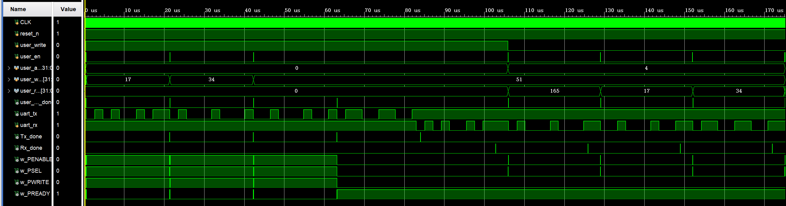

# APB_UART

基于 APB 总线的 UART 串口通信系统（RTL 设计 + Self-checking 验证平台）

## 项目简介

完整的 APB 外设设计及其 testbench 验证环境：

- **APB_uart_Master.v**：三段式 FSM 主机，将简易 user 接口转换为标准 APB 时序
- **APB_uart_Slave.v**：APB 从机，含寄存器组（TX/RX/STA/CTRL）与中断控制
- **uart_tx.v / uart_rx.v**：UART 收发器，8N1 帧格式，波特率可配置
- **APB_uart_top.v**：顶层
- **APB_uart_top_tb.v**：三进程 self-checking 验证平台，5 个测试点全部通过

## 特性

- 标准 APB 从机接口，支持 PREADY 反压（发送忙时自动等待）
- UART 8N1：1 起始位 + 8 数据位（LSB 先行）+ 1 停止位，无校验
- 时钟频率、波特率参数化（`CLOCK` / `BAUD`），便于仿真加速与复用
- 收发完成中断（电平型 IRQ），状态寄存器可查询收发状态

## 寄存器地图

- **0x00 TX（W）**：写入低 8 位触发发送；发送忙时写操作由 PREADY 反压等待
- **0x04 RX（R）**：读接收数据（读操作同时清除 RX 中断标志）
- **0x08 STA（R）**：状态寄存器
  - bit6 tx_busy：发送忙标志
  - bit5 tx_irq_en：发送中断使能
  - bit4 rx_irq_en：接收中断使能
  - bit3 tx_irq_flag：发送中断标志（写 CTRL bit31 清除）
  - bit2 rx_irq_flag：接收中断标志（读 RX 寄存器清除）
  - bit1 Tx_done：发送完成（单拍脉冲）
  - bit0 Rx_done：接收完成（单拍脉冲）
- **0x0C CTRL（W）**：bit1:0 中断使能（PSTRB[0] 有效时更新）；bit31 写 1 清除 TX 中断标志

## 验证平台

TB 采用三进程并发架构：

- **进程1（上位机）**：通过 user 口发起 APB 读写事务（task 封装）
- **进程2（外部串口设备）**：维护 uart_rx 空闲电平，RX 串行激励由 task 驱动
- **进程3（scoreboard）**：按比特中点采样解析 uart_tx 线上的 8N1 帧，还原字节并比对

期望值由两个单生产者单消费者（SPSC）邮箱记账：发起一笔激励记一笔，收到一笔响应销一笔，测试结束对账归零，杜绝"看起来没问题"的模糊结论。

**仿真加速**：DUT 的 `CLOCK` 为 parameter，TB 实例化时覆盖为 1 MHz（默认 50 MHz 的 1/20），位时间 104 拍 ≈ 2.08 μs，协议时序关系不变。

### 测试点与结果

- **1a 复位初态**：uart_tx 空闲高电平、IRQ 为 0 —— PASS
- **1b 寄存器复位值**：STA 读回全 0 —— PASS
- **2 TX 单字节**：线上帧解析后与期望值比对 —— PASS
- **3 TX 背靠背 3 字节**：覆盖 PREADY 反压等待链路 —— PASS
- **4 RX 单字节**：线上激励 → DUT 接收 → APB 读回比对 —— PASS
- **5 RX 连续 3 字节**：发一个读一个（受无 RX FIFO 约束）—— PASS

仿真结束于 175131 ns，全部 PASS，超时看门狗（1 ms）未触发。

### 验证中发现并修复的 RTL bug

**现象**：TX 背靠背写时数据丢失，单笔写完全正常。

**定位**：日志二分确认"总线握手完成但数据未被接受"→ TB 层次引用监视 `send_go` / `PREADY` / `state_cur` 取证。

**根因**：状态机状态寄存器与输出寄存器同拍更新，输出逻辑使用旧状态——进入 ENABLE 状态的第一拍 `PENABLE` 尚未拉高，而 `PENABLE=0` 时 `PREADY` 恒为 1，主机误判从机就绪提前结束访问，该笔写被静默丢弃；单笔写因 DONE 状态多保持一拍总线信号被从机"捡漏"接受，故从未暴露。

**修复**（一行）：ENABLE 状态退出条件改为 `if (r_PENABLE && PREADY)`。

**回归**：修复后全部测试点通过。该类问题若引入 SVA 断言（"ENABLE 且 PREADY 为低，则下一拍必须保持 ENABLE"）可在仿真中自动拦截。

## 使用方式

1. Vivado 新建工程，将设计文件加入 Design Sources，`APB_uart_top_tb.v` 加入 Simulation Sources
2. 右键 `APB_uart_top_tb` → Set as Top → Run Behavioral Simulation
3. 预期 Tcl Console 输出若干 `TX OK / RX OK` 与全部 `TEST POINT PASSED`

## 已知局限

- 无 RX FIFO：背靠背接收依赖软件及时读走数据（测试序列已按此约束设计）
- 无校验位、无帧错误检测（帧格式错误的行为未定义）
- uart_tx 内含"上电约 1 秒自动发送"演示逻辑（开发板遗留；测试在 20 ms 内完成，不受影响）
- 设计文件未声明 `timescale`，仿真时会有无害警告，可忽略或自行补充

## License

MIT
